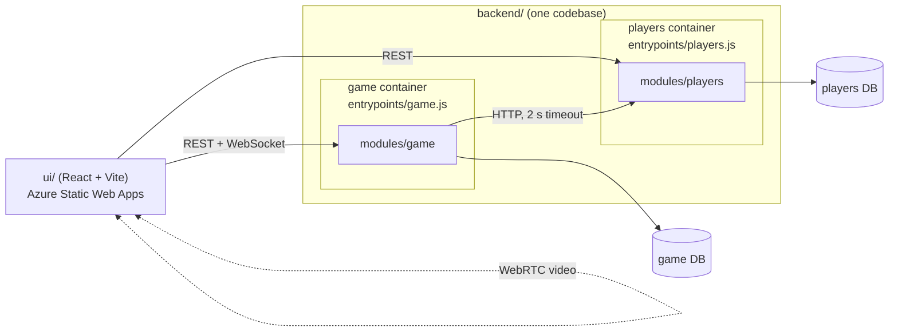

# Architecture and repository structure

How the code is organised and where everyone's work goes. Read this before your first pull
request. If something does not fit, change this document in a PR instead of working around it.

## 1. In one sentence

**A modular monolith codebase, deployed as two services.** All backend code lives in one project
(`backend/`), split into two modules by business area, `game` and `players`. Every module has the
same four folders. Each module is deployed as its own container with its own database, because
the assignment requires two services; that is why modules never call each other in memory but
over HTTP.



Why this shape (slides "Modular Monolith with Internal Architecture" and "Microservices"):

- **One codebase** gives everyone the same structure, tooling, lint rules and test setup, and one
  place to look for anything. A modular monolith is the textbook choice for a small team and an MVP.
- **Modules by business area** (`game`, `players`) with no imports between them keep the
  boundaries clean, exactly as they would be in a modular monolith.
- **Two deployments** are required by the assignment. We get failure isolation (games keep
  working when the players service is down) and pay with network calls and two databases.

## 2. The repository

```
pokerface/
├── backend/                      one Node.js project for both services
│   ├── package.json              shared dependencies, scripts, lint and test config
│   ├── Dockerfile.game           game container        (Person 3)
│   ├── Dockerfile.players        players container     (Person 4)
│   ├── src/
│   │   ├── entrypoints/          one start file per container
│   │   │   ├── game.js           (Person 3)
│   │   │   └── players.js        (Person 4)
│   │   ├── shared/               logger, request log, CORS, errors, /health, config,
│   │   │                         HTTP client with timeout, migration runner (Person 6)
│   │   └── modules/
│   │       ├── game/             (Persons 2 and 3)
│   │       │   ├── domain/       poker engine: pure rules             (Person 2)
│   │       │   ├── application/  use cases + ports                    (Person 3)
│   │       │   ├── infrastructure/ SQL, live tables, players client, turn timer (Person 3)
│   │       │   ├── api/          REST routes + WebSocket              (Person 3)
│   │       │   └── migrations/   SQL schema of the game DB            (Person 3)
│   │       └── players/          (Person 4)
│   │           ├── domain/       name validation, leaderboard ranking
│   │           ├── application/  use cases + ports
│   │           ├── infrastructure/ SQL repositories
│   │           ├── api/          REST routes
│   │           └── migrations/   SQL schema of the players DB
│   └── test/                     mirrors src/: test/modules/game/domain/…, test/shared/…
├── ui/                           React + Vite, built to static files (Person 5)
│   └── src/
│       ├── api/                  the only code that talks to the backend
│       ├── features/             profile, lobby, table, gestures (P1), video (P4), leaderboard
│       ├── components/           small reusable pieces
│       └── config.js             service URLs from environment variables
├── infra/                        Bicep for the Azure resources (Person 6)
├── .github/workflows/            CI and CD (Person 6)
├── docker-compose.yml            runs everything locally from a clean clone (Person 6)
└── docs/
    ├── architecture.md           this file
    ├── contracts.md              every data format between parts
    ├── decisions.md              decision records (4 to 6)
    ├── data-model.md             entities and relationships, per database
    └── scrum/                    Definition of Done, one file per sprint
```

Every folder that needs explaining has a short `README.md` saying what goes in it.

## 3. Inside a module: always the same four folders

| Folder            | What goes in it                                                                                         | Example (game)                           | Example (players)                    |
| ----------------- | ------------------------------------------------------------------------------------------------------- | ---------------------------------------- | ------------------------------------ |
| `domain/`         | Pure business rules. No frameworks, no database, no network.                                            | the poker engine                         | name validation, leaderboard ranking |
| `application/`    | Use cases: what the module can do, step by step. Talks to the outside only through **ports** passed in. | `act(tableId, playerId, action)`         | `createProfile(name)`                |
| `infrastructure/` | Implementations of the ports: SQL, HTTP calls to the other service, timers, memory.                     | `tableRepository.js`, `playersClient.js` | `profileRepository.js`               |
| `api/`            | How clients reach the module: routes, WebSocket. Checks input, calls application, maps errors.          | REST lobby + WebSocket                   | REST profiles, results, leaderboard  |

Plus `migrations/` (the module's database schema) and `index.js` (the one function the
entrypoint calls to build the module, e.g. `createGameModule(config)`).

### Dependency rules

```
api ─────────────┐
                 ▼
infrastructure ─► application ─► domain
                 ▲
entrypoint ──────┘ (builds infrastructure, passes it to application as ports)
```

| Code in                             | May import                           | Must never import                                                                           |
| ----------------------------------- | ------------------------------------ | ------------------------------------------------------------------------------------------- |
| `modules/X/domain/`                 | its own `domain/`                    | anything else: application, infrastructure, api, shared, another module, express, mssql, ws |
| `modules/X/application/`            | its own `domain/` and `application/` | infrastructure, api, shared, another module, express, mssql, ws, `fetch`                    |
| `modules/X/infrastructure/`, `api/` | its own module, `shared/`, libraries | another module                                                                              |
| `shared/`                           | libraries                            | any module                                                                                  |
| `entrypoints/`                      | everything                           | (nothing imports an entrypoint)                                                             |

**`npm run lint` enforces every row of this table.** A pull request that breaks a boundary fails CI.

**Modules never import each other.** They run in different containers, so an import would not even
work in production. The game module needs player names and saves results by calling the players
service over HTTP, from `game/infrastructure/playersClient.js`.

### Ports

A port is what the application needs from the outside, written as JSDoc in
`application/ports.js`. The entrypoint passes the real implementation; tests pass a fake.

| Module  | Port                                    | Real implementation                                   | Fake in tests                      |
| ------- | --------------------------------------- | ----------------------------------------------------- | ---------------------------------- |
| game    | `LiveTables`                            | `infrastructure/liveTables.js` (a `Map`)              | a `Map`                            |
| game    | `TableRepository`                       | `infrastructure/tableRepository.js` (SQL)             | in-memory array                    |
| game    | `PlayersClient`                         | `infrastructure/playersClient.js` (HTTP, 2 s timeout) | object that returns data or throws |
| game    | `Notifier`                              | `api/` WebSocket                                      | array recording messages           |
| game    | `TurnTimer`                             | `infrastructure/turnTimer.js`                         | triggered by hand                  |
| players | `ProfileRepository`, `ResultRepository` | `infrastructure/*.js` (SQL)                           | in-memory arrays                   |

### Example: a use case and its test

```js
// backend/src/modules/game/application/tableService.js
import { act as engineAct, viewTable } from "../domain/index.js";
import { AppError } from "./errors.js";

/** @param {{ liveTables, tableRepository, playersClient, notifier, turnTimer, logger }} ports */
export function createTableService(ports) {
  return {
    async act(tableId, playerId, action) {
      const table = ports.liveTables.get(tableId);
      if (!table)
        throw new AppError("TABLE_NOT_FOUND", "This table does not exist");
      const next = engineAct(table, playerId, action);
      ports.liveTables.save(tableId, next);
      // …save the result if the hand ended, send views, restart the timer
      return viewTable(next, playerId);
    },
  };
}
```

```js
// backend/test/modules/game/application/tableService.test.js: no Express, no database, no network
const sent = [];
const service = createTableService({
  liveTables: new Map(),
  notifier: {
    sendTo: (tableId, playerId, message) => sent.push({ playerId, message }),
  },
  playersClient: {
    saveHandResult: async () => {
      throw new Error("down");
    },
  },
  // …other fakes
});
```

### How a request flows: a player raises

1. `game/api` (WebSocket) receives `{ "type": "action", "action": { "type": "raise", "amount": 60 } }`,
   checks its shape and calls `tableService.act(tableId, playerId, action)`.
2. `game/application` loads the table from `LiveTables`, calls the engine in `game/domain`, saves
   the new table.
3. If the hand ended, it calls `TableRepository.saveHand(result)` and
   `PlayersClient.saveHandResult(result)`. If the players service is down or slow, it logs a
   warning and **the game continues**.
4. It sends every player their own `viewTable(table, playerId)` through the `Notifier` and restarts
   the `TurnTimer`.
5. Errors go back only to that player as `{ "type": "error", "code", "message" }`.

## 4. UI

```
ui/src/
├── api/          gameApi.js, playersApi.js, gameSocket.js: the ONLY code that calls the backend
├── features/     one folder per feature, each with its own components and hooks
│   ├── profile/      create, view, edit, delete your profile        (Person 5)
│   ├── lobby/        create a table, join by code                   (Person 5)
│   ├── table/        seats, cards, pot, timer, buttons, raise slider (Person 5)
│   ├── gestures/     hand tracking, hold-to-confirm, tutorial       (Person 1)
│   ├── video/        WebRTC between players                         (Person 4)
│   └── leaderboard/  leaderboard page                               (Person 5)
├── components/   small reusable pieces: Card, Button, ErrorBanner, ProgressRing
└── config.js     VITE_GAME_URL, VITE_PLAYERS_URL
```

- The UI is modular the same way: one folder per feature. A feature may use `api/` and
  `components/`, never another feature's internals.
- The gesture feature outputs exactly the action objects of `docs/contracts.md` and takes the raise
  limits from `legalActions`. The server decides what is legal, not the UI.

## 5. Shared contracts

Every format that crosses a boundary (REST APIs, WebSocket messages, actions, the table view,
hand results, error codes) is defined once in [`docs/contracts.md`](contracts.md).

## 6. Conventions

- **Health:** `GET /health` returns `200 {"status":"ok"}` and does not depend on the other service.
- **Logs:** one JSON line per request to stdout: `method`, `path`, `status`, `durationMs`. INFO
  level, no request bodies, never hole cards.
- **Errors:** clients get `{ "code", "message" }`; stack traces only go to the logs.
- **Configuration:** only environment variables, read in `shared/config.js`. No URLs, keys or
  connection strings in the code.
- **Migrations:** numbered SQL files per module, applied on startup, never edited after merging.
- **Tests:** in `backend/test/`, mirroring `src/`. Coverage is checked per module on
  `domain/` + `application/`: each module needs at least 70%.
- **Style:** ESLint + Prettier for the whole backend. CI fails on lint or format errors.
- **Branches:** `feature/<short-name>`, `fix/<short-name>`, `docs/<short-name>`. Every change
  reaches `main` through a reviewed pull request.
