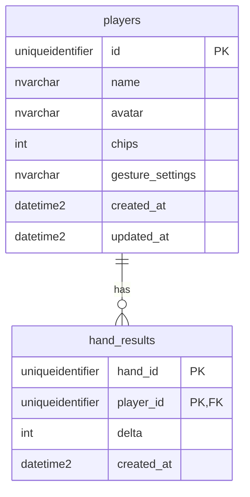
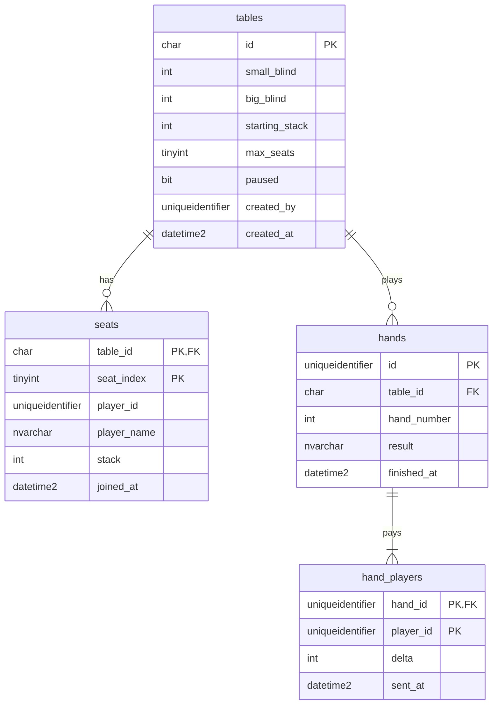

# Data model

Each service owns its own database and no service reads another's tables. This file describes both. The diagrams must match the numbered migrations in each service's `migrations/` folder.

## Players service

Database `players`, owned by `services/players/`. Owner: Laura.

> The tables below are created by `services/players/migrations/002_players.sql`, plus an index added by `003_hand_results_player_index.sql`. `health_checks` comes from `001_health.sql` and is only used by `/health`.



### `players`

| Column | Type | Notes |
|---|---|---|
| `id` | `UNIQUEIDENTIFIER` | Primary key, generated by the service. The browser keeps it in `localStorage` (no passwords). |
| `name` | `NVARCHAR(30)` | Required, 1–30 characters. |
| `avatar` | `NVARCHAR(7)` | Hex colour such as `#B8F23A`. Defaults to one of the six player colours in `docs/styling.md`. |
| `chips` | `INT` | Starts at 1000. Never below 0. Only changed by saving hand results, never by the client. |
| `gesture_settings` | `NVARCHAR(MAX)` | JSON text, for example `{"holdMs":1000}`. |
| `created_at`, `updated_at` | `DATETIME2` | UTC. |

### `hand_results`

One row per player per finished hand.

| Column | Type | Notes |
|---|---|---|
| `hand_id` | `UNIQUEIDENTIFIER` | Created by the game service. |
| `player_id` | `UNIQUEIDENTIFIER` | Foreign key to `players.id`. |
| `delta` | `INT` | Chips won (positive) or lost (negative) in that hand. |
| `created_at` | `DATETIME2` | UTC. |

The primary key is (`hand_id`, `player_id`). It makes saving a result idempotent: if the game service retries after a timeout, the second insert is detected and the chips are not changed again.

An index on `player_id` (`IX_hand_results_player`, with `delta` included, migration `003`) lets the balance be summed per player without scanning other players' rows. Without it, simultaneous saves for different players deadlocked.

### Rules

- **Saving a result** inserts the `hand_results` row and updates `players.chips` in one transaction, locking the player's row so two retries of the same hand run one after the other.
- **Chip balance** is the starting stack (1000) plus the sum of all saved `delta` values, limited to 0 up to the maximum `INT`. It is recomputed from `hand_results` each time, not adjusted from the previous balance, so the order in which results arrive does not change the final balance. For example, a loss of 1500 that arrives before an earlier win of 1000 still ends at 500.
- **Leaderboard** is computed from `players.chips`, highest first, ties broken by name, top 10 (issue #15). It has no table of its own.
- **Deleting a player** also deletes their `hand_results` rows.

### HTTP contract

All errors use `{ "message": "...", "code": "..." }`. Codes: `INVALID_INPUT` (400), `NOT_FOUND` (404), `UNAVAILABLE` (503).

| Request | Body | Success response |
|---|---|---|
| `POST /players` | `{ name, avatar?, gestureSettings? }` | `201` + Player |
| `GET /players/:id` | | `200` + Player |
| `PUT /players/:id` | `{ name, avatar?, gestureSettings? }` | `200` + Player |
| `DELETE /players/:id` | | `204` |
| `POST /players/:id/results` | `{ handId, delta }` (`delta` is an integer) | `200` + updated Player, also when `handId` was already saved |
| `GET /leaderboard` | | `200` + top 10 as `[{ id, name, chips }]` |

Player as returned by the API:

```json
{ "id": "uuid", "name": "Laura", "avatar": "#B8F23A", "chips": 1000,
  "gestureSettings": { "holdMs": 1000 } }
```

`chips` in a request body is ignored.

## Game service

Database `game`, owned by `services/game/`. Owner: Lara.

> The tables below are created by `services/game/migrations/002_tables.sql`, plus the `paused` column added by `003_table_paused.sql`. `health_checks` comes from `001_health.sql` and is only used by `/health`.



### `tables`

One row per private table. The settings use the same rules as the poker engine, so the database never holds a table the engine would reject.

| Column | Type | Notes |
|---|---|---|
| `id` | `CHAR(6)` | Primary key and join code, e.g. `K7QX2M`. Exactly 6 uppercase letters or digits, checked with a binary collation so lowercase is rejected. The UI uses it in `/tables/:id`. |
| `small_blind`, `big_blind` | `INT` | Default 5 and 10. Positive, small blind not above the big blind. |
| `starting_stack` | `INT` | Chips a player gets when they first sit down. Default 1000, at least one big blind. |
| `max_seats` | `TINYINT` | 2 to 6, default 6. |
| `paused` | `BIT` | Set by the creator. While it is 1, the hand being played finishes but no new hand starts. Default 0. |
| `created_by` | `UNIQUEIDENTIFIER` | Player id from the players service. |
| `created_at` | `DATETIME2` | UTC. |

### `seats`

Who sits where, and with how many chips.

| Column | Type | Notes |
|---|---|---|
| `table_id` | `CHAR(6)` | Foreign key to `tables.id`. |
| `seat_index` | `TINYINT` | 0 to 5. |
| `player_id` | `UNIQUEIDENTIFIER` | Player id from the players service. |
| `player_name` | `NVARCHAR(30)` | Copied from the players service when the player joins. |
| `stack` | `INT` | Chips the player has at this table. Starts at `tables.starting_stack` and is updated after every hand. Never below 0. |
| `joined_at` | `DATETIME2` | UTC. |

The primary key is (`table_id`, `seat_index`), so a seat holds one player. A unique constraint on (`table_id`, `player_id`) stops a player from taking two seats at the same table.

### `hands`

One row per finished hand.

| Column | Type | Notes |
|---|---|---|
| `id` | `UNIQUEIDENTIFIER` | Primary key, generated by the game service. Sent to the players service as `handId`. |
| `table_id` | `CHAR(6)` | Foreign key to `tables.id`. |
| `hand_number` | `INT` | 1, 2, 3… within the table. Unique per table. |
| `result` | `NVARCHAR(MAX)` | JSON with what the players saw at the end: board, revealed cards and winners. |
| `finished_at` | `DATETIME2` | UTC. |

### `hand_players`

One row per player per finished hand.

| Column | Type | Notes |
|---|---|---|
| `hand_id` | `UNIQUEIDENTIFIER` | Foreign key to `hands.id`. |
| `player_id` | `UNIQUEIDENTIFIER` | Player id from the players service. |
| `delta` | `INT` | Chips won (positive) or lost (negative) in that hand, as computed by the engine. |
| `sent_at` | `DATETIME2` | `NULL` until the players service has saved this result. |

The primary key is (`hand_id`, `player_id`). Each row is one call to `POST /players/:id/results { handId, delta }`. A filtered index (`IX_hand_players_unsent`) finds the rows whose `sent_at` is still `NULL`, so they can be sent again quickly.

### Rules

- **No foreign keys to `players`.** Each service owns its database, so `player_id` is checked by calling `GET /players/:id` when the player joins, not by the database. The name is copied into `seats` so a table keeps working if the players service goes down.
- **Hands in progress are not stored.** The live state (deck, cards, bets, whose turn it is, the turn timer) lives in memory in the game service. When a hand ends, the service writes the `hands` row, its `hand_players` rows and the new `seats.stack` values in one transaction. If the container scales to zero or restarts, only the hand in progress is lost; tables, seats with their stacks and finished hands are kept.
- **Restoring a table.** After a restart, a table is loaded into memory the first time it is used: the engine gets the saved settings, seats and stacks, and its hand counter continues from the highest `hand_number` of the table, so new hands never clash with `UQ_hands_table_number`.
- **Saving a hand is safe to repeat.** If the database fails when a hand ends, the table waits and retries with the same `hands.id`, and starts no new hand until it is saved. A hand whose `id` is already stored is not inserted again.
- **Sending results.** After saving a hand, the game service sends each `hand_players` row to the players service and sets `sent_at` when it succeeds. Rows that failed because the players service was down, timed out or returned a 5xx keep `sent_at` as `NULL` and are sent again after the next hand. A `404` means the player deleted their profile, so the row is marked as sent and not retried. The players service ignores a `handId` it has already saved for that player, so a retry never counts twice.
- **Deleting a table** also deletes its seats, its hands and their `hand_players` rows. It is refused while a hand is being played or has not been saved yet.