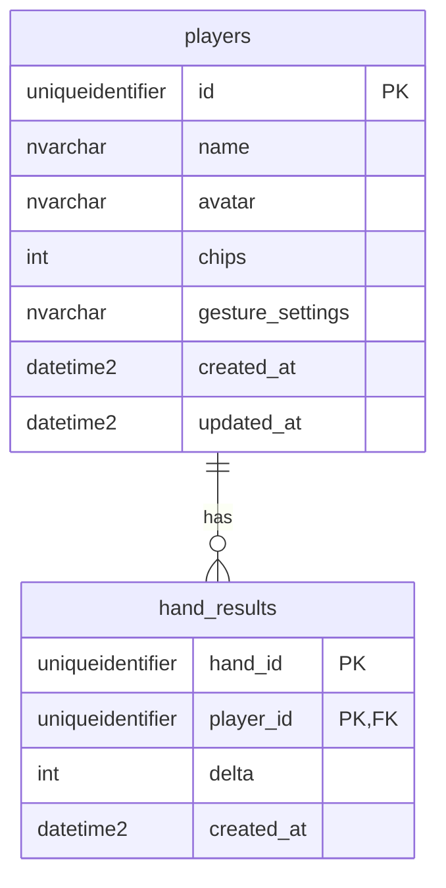

# Data model

Each service owns its own database and no service reads another's tables. This file describes both. The diagrams must match the numbered migrations in each service's `migrations/` folder.

## Players service

Database `players`, owned by `services/players/`. Owner: Laura.

> The tables below are created by `services/players/migrations/002_players.sql`. `health_checks` comes from `001_health.sql` and is only used by `/health`.



### `players`

| Column | Type | Notes |
|---|---|---|
| `id` | `UNIQUEIDENTIFIER` | Primary key, generated by the service. The browser keeps it in `localStorage` (no passwords). |
| `name` | `NVARCHAR(30)` | Required, 1–30 characters. |
| `avatar` | `NVARCHAR(7)` | Hex colour such as `#B8F23A`. Defaults to one of the six player colours in `docs/styling.md`. |
| `chips` | `INT` | Starts at 1000. Never below 0. Only changed by saving hand results, never by the client. |
| `gesture_settings` | `NVARCHAR(MAX)` | JSON text, for example `{"holdMs":1000}`. |
| `created_at`, `updated_at` | `DATETIME2` | UTC. |

### `hand_results`

One row per player per finished hand.

| Column | Type | Notes |
|---|---|---|
| `hand_id` | `UNIQUEIDENTIFIER` | Created by the game service. |
| `player_id` | `UNIQUEIDENTIFIER` | Foreign key to `players.id`. |
| `delta` | `INT` | Chips won (positive) or lost (negative) in that hand. |
| `created_at` | `DATETIME2` | UTC. |

The primary key is (`hand_id`, `player_id`). It makes saving a result idempotent: if the game service retries after a timeout, the second insert is detected and the chips are not changed again.

### Rules

- **Saving a result** inserts the `hand_results` row and updates `players.chips` in one transaction, locking the player's row so two retries of the same hand run one after the other.
- **Chip balance** is the starting stack (1000) plus the sum of all saved `delta` values, limited to 0 up to the maximum `INT`. It is recomputed from `hand_results` each time, not adjusted from the previous balance, so the order in which results arrive does not change the final balance. For example, a loss of 1500 that arrives before an earlier win of 1000 still ends at 500.
- **Leaderboard** is computed from `players.chips`, highest first, ties broken by name, top 10 (issue #15). It has no table of its own.
- **Deleting a player** also deletes their `hand_results` rows.

### HTTP contract

All errors use `{ "message": "...", "code": "..." }`. Codes: `INVALID_INPUT` (400), `NOT_FOUND` (404), `UNAVAILABLE` (503).

| Request | Body | Success response |
|---|---|---|
| `POST /players` | `{ name, avatar?, gestureSettings? }` | `201` + Player |
| `GET /players/:id` | | `200` + Player |
| `PUT /players/:id` | `{ name, avatar?, gestureSettings? }` | `200` + Player |
| `DELETE /players/:id` | | `204` |
| `POST /players/:id/results` | `{ handId, delta }` (`delta` is an integer) | `200` + updated Player, also when `handId` was already saved |
| `GET /leaderboard` | | `200` + top 10 as `[{ id, name, chips }]` |

Player as returned by the API:

```json
{ "id": "uuid", "name": "Laura", "avatar": "#B8F23A", "chips": 1000,
  "gestureSettings": { "holdMs": 1000 } }
```

`chips` in a request body is ignored.

## Game service

Database `game`, owned by `services/game/`. Owner: Lara. To be added: `tables`, `seats` and `hands`.
